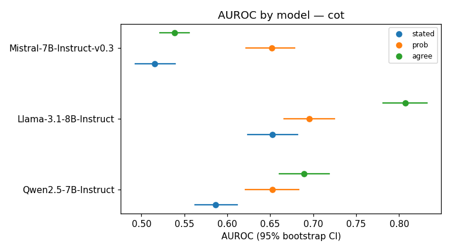

# Which confidence signal works for medical QA?

A pre-registered comparison of three ways to get a confidence score from an open LLM answering USMLE-style
questions (MedQA, 4 options, all 1,273 test questions):

| signal | how it is obtained |
|---|---|
| **stated** | the model writes a number from 0 to 100 after its answer |
| **prob** | probability of the chosen letter right after `Answer:` (option probability) |
| **agree** | share of 5 sampled chain-of-thought answers that match the official answer (sample agreement) |

Models: **Qwen2.5-7B-Instruct**, **Llama-3.1-8B-Instruct**, **Mistral-7B-Instruct-v0.3**, each in two settings:
**CoT** (reason step by step, then answer; primary) and **Direct** (answer immediately; secondary).
Primary metric: AUROC for "answer is correct"; also ECE, adaptive ECE, Brier, overconfidence gap, selective
accuracy at 80% coverage and AURC, with paired bootstrap CIs, paired DeLong tests and Holm correction.

Every choice (prompts, models, sampling, metrics, bins, hypotheses, decision rule, validity flags) was fixed in
[PREREGISTRATION.md](PREREGISTRATION.md) and committed on 2026-10-10, **before any GPU run**.

## Results

All three models passed every pre-registered validity check in both settings (accuracy ≥ 0.40, parse failures
and truncation ≤ 10%, median letter mass ≥ 0.5), so all of them are in the Holm families (9 tests per setting).
Full tables: [results/combined/results_all.md](results/combined/results_all.md).

### CoT (primary)

| model | accuracy | AUROC stated | AUROC prob | AUROC agree | ECE stated | ECE prob | ECE agree |
|---|---|---|---|---|---|---|---|
| Qwen2.5-7B | 0.639 | 0.587 [0.563, 0.612] | 0.653 [0.621, 0.683] | **0.689** [0.661, 0.718] | 0.306 | 0.346 | **0.192** |
| Llama-3.1-8B | 0.690 | 0.653 [0.624, 0.682] | 0.696 [0.666, 0.725] | **0.807** [0.781, 0.832] | 0.166 | 0.287 | **0.083** |
| Mistral-7B | 0.513 | 0.515 [0.493, 0.539] | **0.652** [0.621, 0.678] | 0.539 [0.522, 0.556] | 0.443 | **0.423** | 0.447 |



Hypotheses (supported = Holm-adjusted DeLong p < 0.05 across all models **and** bootstrap CI excludes 0):

| | H1: stated has lower AUROC than prob and agree | H2: stated is overconfident and has the highest ECE | H3: prob and agree differ in AUROC |
|---|---|---|---|
| Qwen2.5-7B | supported | not supported | not supported (p_Holm = 0.052) |
| Llama-3.1-8B | supported (stated vs prob: p_Holm = 0.0498, borderline) | not supported | supported, agree > prob |
| Mistral-7B | not supported (stated ≈ agree, p_Holm = 0.135) | not supported | supported, **prob > agree** |

In the **Direct** setting, H1 holds for all three models, H2 only for Mistral, and H3 for Llama and Mistral
(same directions as in CoT).

### Main findings

1. **Stated confidence is the weakest signal.** In every model it barely separates right from wrong answers
   (AUROC 0.52–0.65), and it collapses onto a few values: 85/95/100 for Qwen, 80/90 for Llama, 95/100 for Mistral.
2. **No raw signal is calibrated.** Stated confidence is strongly overconfident (mean 0.86–0.96 at 51–69%
   accuracy), but option probability is just as overconfident or more (mean 0.94–0.98), which is why H2 fails.
   After 5-fold cross-fitted Platt scaling (exploratory), all ECEs drop to about 0.01–0.05.
3. **Sample agreement only works when the model actually reasons.** It is clearly the best signal for Llama and
   Qwen but nearly useless for Mistral, where option probability wins. Mistral mostly writes `Answer: X` at once
   (mean CoT length 37 tokens vs 208 for Qwen and 386 for Llama), so its 5 samples are identical for 87% of the
   questions (Qwen 53%, Llama 45%). This is why H3 holds in opposite directions for Llama and Mistral.

### Limitations

- **Mistral barely uses chain of thought** under the pre-registered prompt (see above), so its CoT and Direct
  settings are close to each other.
- **Position bias:** Llama over-picks B (406 of 1,273 vs 309 gold), Mistral over-picks A (501 vs 353).
- **Parsing:** Llama wrote no `Answer:` line in 1.3% of greedy CoT outputs, mostly because the reasoning hit the
  1,024-token limit; the pre-registered forced-answer rule handled these. The answer pattern takes the first
  letter of answers like `Answer: A, B, C`, as pre-registered (rare).
- **Determinism:** float16 batching on T4 GPUs makes greedy decoding not perfectly reproducible (7–10 of 10
  repeated outputs were byte-identical). Seeds, model revisions and versions are logged in `run_log.json`.
- **Borderline result:** Llama's H1 depends on an adjusted p of 0.0498.
- Three 7–8B models and one dataset; results may not transfer to larger models or other medical tasks.

## Repository

```
PREREGISTRATION.md           the study protocol, committed before any GPU run
config.py                    pre-registered constants + config hash
src/medqa_conf/
  data.py       load MedQA, fail loudly on counts/schema, clean options, gold-letter distribution
  prompts.py    verbatim prompts and prefills
  parsing.py    answer / confidence parsing
  backends.py   VLLMBackend, HFBackend (own seeded KV-cache decoding loop), MockBackend; smoke test
  generate.py   model calls 1–6, letter distribution, JSONL checkpoint every 50 q, resume, time budget
  signals.py    raw records -> per_question.csv
  metrics.py    AUROC, ECE, adaptive ECE, Brier, tie-aware selective accuracy / risk-coverage / AURC, Wilson
  stats.py      paired bootstrap, fast DeLong, Holm, cross-fitted Platt scaling
  report.py     summary.json / results_table.md / figures from the CSV alone; --from-csv; --combine
  sanity.py     sanity_report.md
  bundle.py     run_log.json, raw_examples.md, share bundle
  pipeline.py   orchestration (+ CPU mock run)
tests/                       CPU tests (toy example, sklearn equality, tie brute force, DeLong, parsing, e2e)
tools/build_kaggle_notebook.py   builds kaggle/*.ipynb with all source inlined
kaggle/generate_and_analyze.ipynb   one model per run (GPU)
kaggle/combine_models.ipynb         merges per-model outputs (CPU)
results/
  combined/                  results_all.md, summary_all.json, AUROC forest plots (final, across models)
  <model_slug>/              per_question.csv, summary.json, results_table.md, sanity_report.md,
                             run_log.json, raw_examples.md, figures/ (reliability, risk-coverage, histograms)
  pilots/<model_slug>_pilot/ pilot_report.md, sanity_report.md, run_log.json (20 train questions each)
```

`per_question.csv` has one row per question × setting with all signals and diagnostics, but no question or
generated text. Raw generations are not in the repository; `raw_examples.md` shows 12 examples per model.

## Reproducing the analysis (CPU, no GPU needed)

Every number in `results/` is computed from the per-model `per_question.csv` files alone.

```bash
pip install numpy scipy pandas scikit-learn matplotlib pytest nbformat nbclient ipykernel
```

```bash
python -m pytest -q
```

```bash
PYTHONPATH=src:. python -m medqa_conf.report --combine results/qwen2_5_7b_instruct results/llama_3_1_8b_instruct results/mistral_7b_instruct_v0_3 --out repro --prereg PREREGISTRATION.md
```

```bash
PYTHONPATH=src:. python -m medqa_conf.report --from-csv results/qwen2_5_7b_instruct/per_question.csv --out repro_qwen
```

The `--combine` command reproduces `results/combined/results_all.md` byte for byte (`summary_all.json` agrees to
about 1e-14; the last digits depend on the numpy version). On Windows, use `;` instead of `:` in `PYTHONPATH`.

Further local checks:

```bash
PYTHONPATH=src:. python -m medqa_conf.pipeline --mock --n 1273 --out outputs_mock
```

```bash
python tools/build_kaggle_notebook.py --execute-mock
```

The first runs the whole pipeline on CPU with a mock model. The second rebuilds both notebooks from `src/` and
executes them on CPU (`MEDQA_MOCK=1`, never set on Kaggle). Always rebuild the notebooks after editing `src/`;
a test fails if they are stale.

## Running the generation on Kaggle

The model runs used Kaggle notebooks with 2× T4 GPUs, Python 3.13, torch 2.11 (CUDA 12.8) and vLLM 0.26.0.
Measured wall time per full run (1,273 questions, both settings): Qwen 0.73 h, Llama 1.71 h, Mistral 0.45 h.

### Settings (once per notebook)

- **Accelerator:** GPU T4 x2. **Internet:** on.
- **Secret:** Add-ons → Secrets → `HF_TOKEN` = a Hugging Face read token, attached to the notebook.
- **Licences:** on Hugging Face, accept the terms for `meta-llama/Llama-3.1-8B-Instruct` (gated) and
  `mistralai/Mistral-7B-Instruct-v0.3` with the same account as the token. Qwen needs nothing.
- Upload `kaggle/generate_and_analyze.ipynb` (File → Import Notebook). It is self-contained: the first code
  cells write the package to `/kaggle/working/medqa_src/`. Always use **Save & Run All**, so these cells run first.

### Per model: pilot, then full run

1. In the first code cell set `MODEL_ID` and `PILOT = True`. **Save & Run All (Commit).**
   The pilot uses 20 **train** questions (never test). Its `pilot_report.md` shows 3 fully rendered prompts with
   raw outputs, parse rates, letter mass, throughput and the projected full runtime. The last cell raises
   `PilotAbort` if the projection exceeds 11 h.
2. If the pilot looks right, set `PILOT = False`, pin `MODEL_REVISION` to the hash in the pilot's `run_log.json`,
   and commit again. Outputs go to `/kaggle/working/outputs/<model_slug>/`.

Revisions used: Qwen `a09a35458c702b33eeacc393d103063234e8bc28`, Llama `0e9e39f249a16976918f6564b8830bc894c89659`,
Mistral `c170c708c41dac9275d15a8fff4eca08d52bab71`. Dataset: `GBaker/MedQA-USMLE-4-options` at revision
`0fb93dd23a7339b6dcd27e241cb9b5eca62d4d18`.

Optional knobs in the first cell: `BACKEND` (`"auto"` = vLLM with transformers fallback; `"vllm"`; `"hf"`),
`TIME_BUDGET_HOURS` (default 11.0), `MODEL_REVISION` (default: latest, resolved and logged).

### Backend selection

The install cell keeps Kaggle's preinstalled torch (pinned in a pip constraints file) and asks pip for the newest
vLLM release built for that torch version. The vLLM wheel on PyPI targets CUDA 13, while Kaggle's torch is a
CUDA 12 build, so for a `cu12x` torch the notebook installs the matching `+cu12x` wheel from the vLLM GitHub
release instead. It then removes `torchcodec` if that package cannot load (vLLM only needs it for video), and
checks that `import vllm` works. The model then loads in a **subprocess smoke test** (TP=2, fp16), so a failed
start cannot leave the kernel holding GPU memory. On T4s, vLLM runs with `gpu_memory_utilization=0.80` and
`max_num_batched_tokens=4096`; with 0.90 the first large batch ran out of memory, because vLLM's budget does
not count about 1.1 GiB of CUDA-graph memory per GPU. These settings do not change the pre-registered config.
If any step fails, the notebook switches to the transformers backend and records why in `run_log.json`
(`backend_note`). All three reported runs used vLLM.

### Resuming an interrupted run

Generation writes `outputs/<slug>/checkpoint.jsonl` every 50 questions and stops on its own before
`TIME_BUDGET_HOURS`, keeping the checkpoint; the last cell then prints `RUN INCOMPLETE`. To resume:

1. Open the notebook → **Add Input** → *Notebook Output Files* → select the previous version of this notebook.
2. Keep `MODEL_ID` / `PILOT` unchanged and **Save & Run All** again.

The notebook reuses finished questions only when model id, config hash, model revision and backend all match;
otherwise it stops with an explanation, because mixing outputs is not allowed.

### Outputs of a run

`/kaggle/working/outputs/<slug>/` (download from the notebook's Output tab):

| file | content |
|---|---|
| `share_bundle_<slug>.zip` | everything below + PREREGISTRATION.md + source code; **no raw generations**; < 5 MB (checked) |
| `per_question.csv` | one row per qid × setting, no raw text |
| `summary.json`, `results_table.md` | every metric, CI, test statistic, p-value, hypothesis verdict |
| `figures/` | reliability diagrams, risk–coverage curves, histograms (per setting) |
| `sanity_report.md`, `run_log.json`, `raw_examples.md` | diagnostics, versions/GPU/revision/seeds/config hash/timings, 12 examples |
| `raw_generations.jsonl.gz`, `checkpoint.jsonl` | raw text (not in the bundle) |

### Combining models

Upload the three full-run Output zips (or the `share_bundle_<slug>.zip` files) to one private Kaggle dataset.
Then import `kaggle/combine_models.ipynb`, add the dataset as input (CPU is enough) and **Save & Run All**. The
notebook finds each model's `per_question.csv` (unpacking zips if needed), ignores pilots and duplicate copies
of the same run, recomputes every model, applies Holm across all pairs × non-flagged models within each setting
(CoT = primary family), and writes `/kaggle/working/combined/share_bundle_all.zip`. The same can be done
locally with `report --combine` (see above).

### How the runtime projection works

In the pilot, `seconds_per_question` = generation wall time for the 20 pilot questions (all six calls) / 20.
Projected full run = measured setup (install + download + smoke test + model load) + `seconds_per_question ×
1273` + the measured determinism re-run + max(measured analysis, 15 min). This is conservative, because the
main run batches 50 questions per chunk and the pilot only 20.

## Notes on interpretation

- The official answer in each setting is the argmax of the letter distribution `p` after `Answer:`. All three
  signals are scored against it. In CoT, the letter written in the reasoning can differ; `sanity_report.md`
  reports how often (≤ 0.2% for all models).
- Complete-case analysis drops questions with a missing signal (in practice only `conf_stated`); no question
  was dropped in the final runs. The median-imputation sensitivity analysis uses all questions.
- Exploratory analyses (majority vote, entropy, rank average, by `meta_info`, Platt-scaled ECE) are labelled as
  such and are not part of the conclusions.

## Data and models

- MedQA (USMLE, 4 options) via [GBaker/MedQA-USMLE-4-options](https://huggingface.co/datasets/GBaker/MedQA-USMLE-4-options);
  original dataset: Jin et al., *What disease does this patient have? A large-scale open domain question
  answering dataset from medical exams*, Applied Sciences 2021.
- Models are used under their own licences:
  [Qwen2.5-7B-Instruct](https://huggingface.co/Qwen/Qwen2.5-7B-Instruct),
  [Llama-3.1-8B-Instruct](https://huggingface.co/meta-llama/Llama-3.1-8B-Instruct),
  [Mistral-7B-Instruct-v0.3](https://huggingface.co/mistralai/Mistral-7B-Instruct-v0.3).
- This is a research project about confidence estimation. Nothing here is medical advice, and none of the
  models should be used for clinical decisions.
